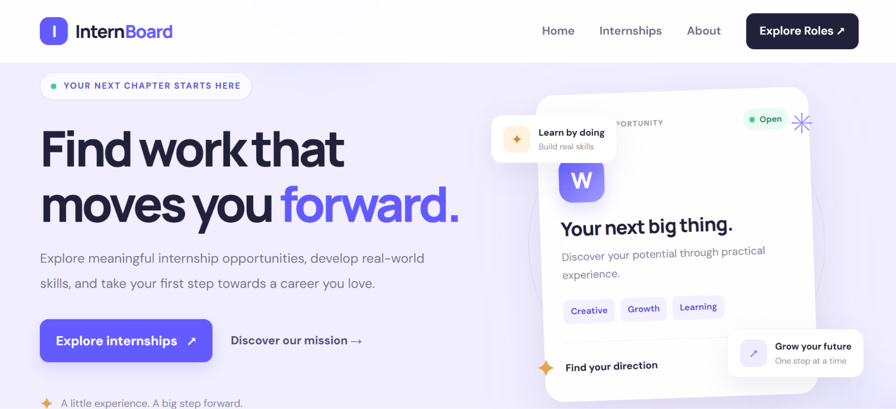
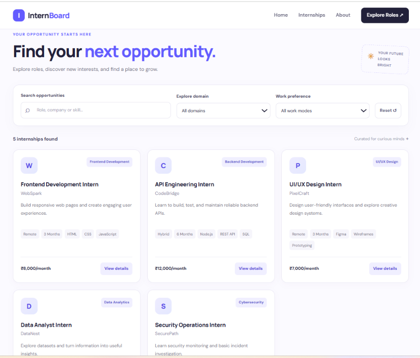
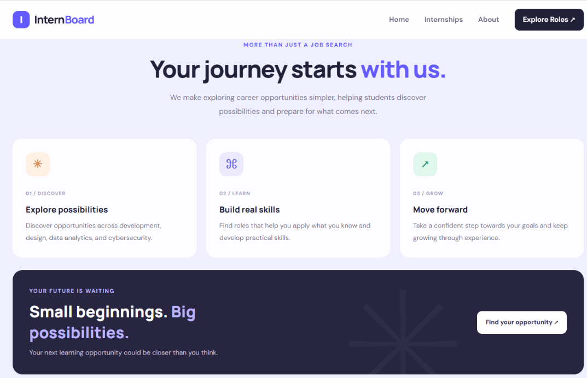

# InternBoard – Responsive Internship Board

A responsive and accessible internship listing website that helps students explore sample internship opportunities across different domains.

## Live Demo

[View InternBoard Website](https://roshnisingh30282006-ux.github.io/responsive-internship-board/)

## Features

- Responsive layout for desktop, tablet, and mobile.
- Internship cards generated dynamically using JavaScript.
- Search internships by role, company, domain, or skill.
- Filter opportunities by domain and work mode.
- View detailed information about each internship.
- Empty state when no matching internships are found.
- Error state with a retry option.
- Keyboard-friendly buttons and visible focus indicators.
- Accessible form labels and semantic HTML elements.

## Technologies Used

- HTML5
- CSS3
- JavaScript (Vanilla JS)

## Screenshots

### Homepage

### Internship Listings

### About Section

## Run Locally

1. Clone or download this repository.
2. Open the project folder.
3. Open `index.html` in your web browser.

## Project Note

The internship records are sample data created for demonstration and learning purposes. They do not represent verified live vacancies.

## Author

Created as part of the EdVyro Full Stack Development Internship Task – Responsive Internship Board.
